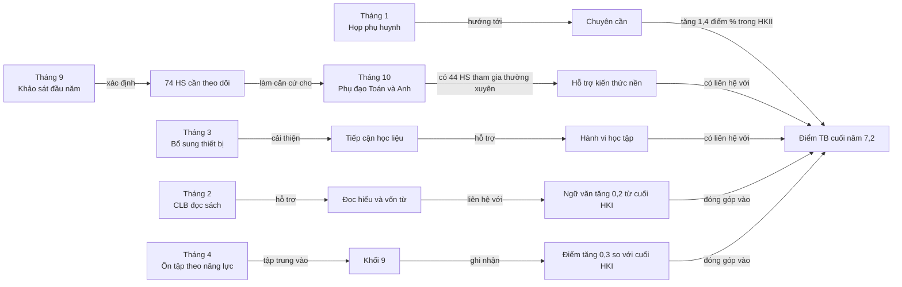
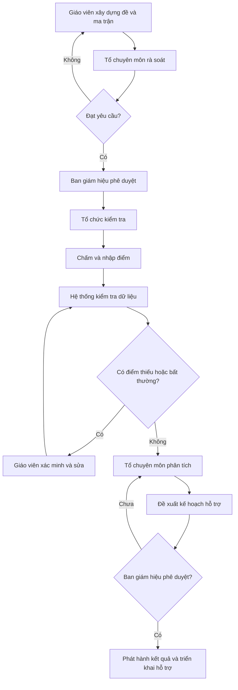

# Báo cáo kết quả học tập năm học 2025–2026

**Trường THCS Hòa Bình — Bản mẫu dành cho Ban giám hiệu**

> Báo cáo được tạo từ `bai-04-sample-02.md`. Dữ liệu hoàn toàn giả lập. Các chênh lệch quan sát không chứng minh quan hệ nhân quả.

## 1. Tóm tắt

- Điểm trung bình toàn trường cuối năm đạt **7,2**, tăng **0,6 điểm** so với đầu năm.
- **73,8%** học sinh đạt mức Khá hoặc Tốt; **16 học sinh (5,0%)** cần hỗ trợ.
- **Tiếng Anh** có điểm trung bình thấp nhất (**6,9**) và số học sinh dưới 5,0 cao nhất (**30 em**), dù đã tăng 0,7 điểm trong năm.
- Lớp **9A** có kết quả cao nhất (**7,8**); lớp **8B** thấp nhất (**6,6**) và có tỷ lệ đi học thấp nhất (**91,8%**).
- Nhóm đi học từ 95% số buổi có điểm trung bình cao hơn nhóm dưới ngưỡng này **1,0 điểm**; đây là liên hệ quan sát, chưa đủ để kết luận chuyên cần là nguyên nhân duy nhất.
- Nhóm hoàn thành từ 90% bài tập đúng hạn có điểm trung bình cao hơn nhóm đối chiếu **1,2 điểm**, là chênh lệch lớn nhất trong các yếu tố được ghi nhận.
- Ưu tiên học kỳ tới: hỗ trợ Tiếng Anh và lớp 8B, duy trì phụ đạo có theo dõi, cải thiện chuyên cần và chuẩn hóa dữ liệu đánh giá.

## 2. Taxonomy các yếu tố liên quan

| Nhóm yếu tố | Thành phần | Kết quả có liên hệ | Mức độ cần chú ý |
|---|---|---|---|
| Hành vi học tập | Thời lượng tự học, hoàn thành bài tập đúng hạn | Điểm chung, Toán, Tiếng Anh | Cao |
| Chuyên cần | Tỷ lệ đi học, nghỉ không phép | Điểm chung, số HS cần hỗ trợ | Cao |
| Hỗ trợ học thuật | Phụ đạo, ôn tập theo nhóm năng lực, câu lạc bộ đọc sách | Toán, Tiếng Anh, Ngữ văn, khối 9 | Trung bình–cao |
| Điều kiện tiếp cận | Thiết bị học trực tuyến ổn định | Điểm chung và khả năng tiếp cận học liệu | Trung bình |
| Phối hợp gia đình | Phụ huynh tham gia trao đổi | Điểm chung và chuyên cần | Trung bình |
| Năng lực đầu vào | Điểm khảo sát đầu năm | Mức tiến bộ và nhu cầu hỗ trợ | Cần kiểm soát khi phân tích |

## 3. Các yếu tố theo môn học

### 3.1. Toán

- Điểm trung bình tăng từ **6,6 lên 7,3**.
- Nhóm tự học dưới 3 giờ/tuần đạt **6,1**, trong khi nhóm từ 7 giờ đạt **8,1**.
- Có **20 học sinh** dưới 5,0; lớp 8B có tỷ lệ cao nhất (**15,0%**).
- Phụ đạo bắt đầu từ tháng 10 có liên hệ với cải thiện kết quả, nhưng chưa có nhóm đối chứng và chưa kiểm soát năng lực đầu vào.

### 3.2. Ngữ văn

- Điểm trung bình tăng từ **6,9 lên 7,3**, mức tăng thấp nhất trong bốn môn (**+0,4**).
- Câu lạc bộ đọc sách triển khai từ tháng 2; điểm môn tăng **0,2** từ cuối HKI đến cuối HKII.
- Chỉ có **12 học sinh** dưới 5,0, thấp nhất trong bốn môn.

### 3.3. Tiếng Anh

- Điểm trung bình tăng **0,7**, nhưng kết quả cuối năm vẫn thấp nhất (**6,9**).
- Có **30 học sinh** dưới 5,0; lớp 8B có tỷ lệ cao nhất (**20,0%**).
- Chênh lệch điểm giữa nhóm tự học dưới 3 giờ và từ 7 giờ trở lên là **2,0 điểm**.
- Đây là môn cần ưu tiên phân tích sâu về chuyên cần, bài tập đúng hạn và mức tham gia phụ đạo.

### 3.4. Khoa học tự nhiên

- Điểm trung bình tăng từ **6,7 lên 7,2**.
- Có **18 học sinh** dưới 5,0; lớp 7B có tỷ lệ cao nhất (**12,5%**).
- Dữ liệu hiện tại chưa có yếu tố can thiệp riêng cho môn; cần tránh quy kết mức tiến bộ cho các chương trình hỗ trợ chung.

## 4. Concept map: thời gian, can thiệp và kết quả

**Cách đọc:** sơ đồ cho thấy mốc thời gian, can thiệp, yếu tố trung gian và kết quả quan sát. Các mũi tên “hỗ trợ”, “liên hệ” hoặc “đóng góp” không được hiểu là bằng chứng nhân quả.

## 5. Quy trình kiểm tra và đánh giá

Các điểm kiểm soát bắt buộc:

1. Đề kiểm tra phải được rà soát trước khi phê duyệt.
2. Điểm thiếu hoặc ngoài phạm vi 0–10 phải được xác minh.
3. Kết quả và kế hoạch hỗ trợ chỉ phát hành sau khi Ban giám hiệu phê duyệt.

## 6. Bảng tổng kết thành tích

| Chỉ số | Kết quả cuối năm | So sánh | Đánh giá |
|---|---:|---:|---|
| Điểm TB chung | 7,2 | +0,6 so với đầu năm | Cải thiện |
| Học sinh mức Tốt | 70 (21,9%) | Chưa có dữ liệu năm trước | Cần bổ sung mốc so sánh |
| Học sinh mức Khá | 166 (51,9%) | — | Nhóm chiếm tỷ trọng lớn nhất |
| Học sinh mức Đạt | 68 (21,2%) | — | Cần theo dõi để tránh tụt mức |
| Học sinh cần hỗ trợ | 16 (5,0%) | — | Cần kế hoạch cá nhân hóa |
| Môn có điểm cao nhất | Toán và Ngữ văn: 7,3 | — | Duy trì |
| Môn có điểm thấp nhất | Tiếng Anh: 6,9 | +0,7 so với đầu năm | Có tiến bộ nhưng cần ưu tiên |
| Lớp có điểm cao nhất | 9A: 7,8 | — | Có thể khai thác thực hành tốt |
| Lớp cần chú ý nhất | 8B: 6,6 | Đi học 91,8% | Ưu tiên can thiệp |

## 7. Khuyến nghị hành động

1. Lập kế hoạch 8–10 tuần hỗ trợ Tiếng Anh, ưu tiên học sinh dưới 5,0 và lớp 8B.
2. Với các lớp có chuyên cần dưới 95%, theo dõi hằng tuần và phối hợp phụ huynh theo ngưỡng cảnh báo rõ ràng.
3. Đo tỷ lệ hoàn thành bài tập đúng hạn theo môn, thay vì chỉ dùng số liệu tổng hợp toàn trường.
4. Đánh giá hiệu quả phụ đạo bằng điểm trước–sau và mức tham gia, đồng thời kiểm soát điểm đầu vào.
5. Bổ sung dashboard theo lớp, môn và thời gian để phát hiện sớm thay vì chờ cuối học kỳ.

## 8. Hạn chế dữ liệu

- Thời lượng tự học là dữ liệu tự báo cáo, có thể thiếu chính xác.
- Chưa kiểm soát năng lực đầu vào khi so sánh các nhóm yếu tố.
- Chưa có dữ liệu năm học trước để đánh giá xu hướng dài hạn.
- Không có dữ liệu chi tiết theo từng học sinh trong bộ mẫu này.
- Không được suy đoán giới tính, hoàn cảnh kinh tế hoặc nguyên nhân cá nhân từ dữ liệu hiện có.

---

*SID Coach Pro v5.0 — Powered by Structured Intelligence Design Framework - Binh Truong*
